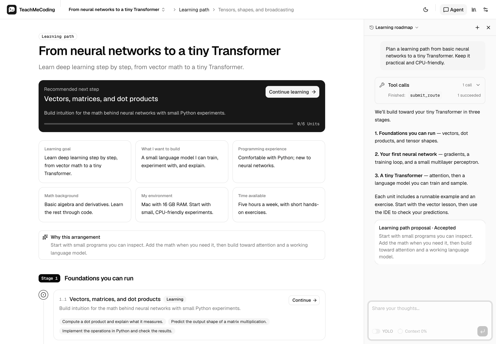
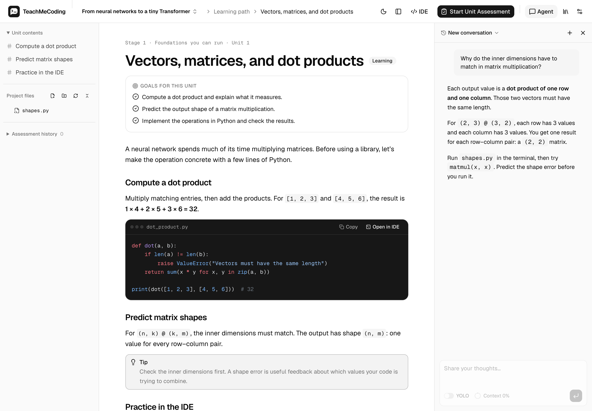
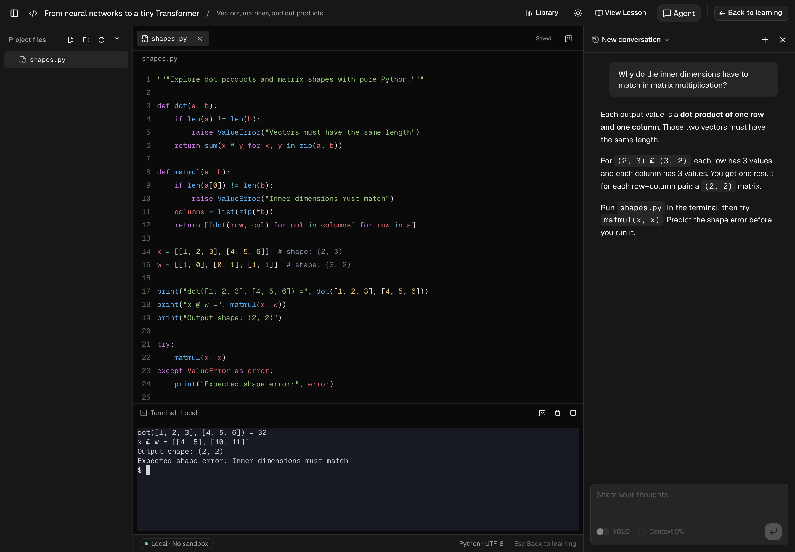

<p align="center">
  
</p>

<h1 align="center">TeachMeCoding</h1>

<p align="center">
  English · <a href="README.zh.md">简体中文</a>
</p>

<p align="center">
  An AI coding tutor that runs locally: turn learning goals into a roadmap and lessons, practice in real projects, and get assessed using real execution results.
</p>

<p align="center">
  <a href="LICENSE"></a>
  
  
  
  
</p>

<p align="center">
  <a href="#quick-start">Quick start</a> ·
  <a href="#documentation">Documentation</a> ·
  <a href="CONTRIBUTING.md">Contributing</a> ·
  <a href="SECURITY.md">Security</a>
</p>



TeachMeCoding creates a separate learning space for each learning goal. The teaching agent clarifies your needs, plans a learning roadmap, and writes lessons. You practice in the built-in IDE and local terminal, and coding submissions run on your machine before the model evaluates the results. All data is stored locally in SQLite and project directories, and the entire application runs in a single Node process.

> [!WARNING]
> The agent can read files, run Bash commands, and access the network with the permissions of the system account running the server. It is **not a sandbox**. Run it only in an environment where you trust the model, tools, and reference materials. See [SECURITY.md](SECURITY.md).

## Contents

- [Features](#features)
- [Project status](#project-status)
- [Quick start](#quick-start)
- [Usage](#usage)
- [Configuration](#configuration)
- [Documentation](#documentation)
- [Contributing](#contributing)
- [Acknowledgments](#acknowledgments)
- [License](#license)

## Features

- **A complete learning workflow**: clarify your needs → plan a roadmap → study lessons and practice coding → receive assessments and feedback.
- **An adaptable learning roadmap**: organized into stages and units, with units unlocking in order once lessons for preceding units are ready.
- **Real projects and terminals**: each learning space has a project directory on disk. The editor saves as you type, and the terminal is a real shell.
- **Assessments backed by execution evidence**: coding submissions run locally and their output is checked, with support for Python, JavaScript, TypeScript, Rust, and Bash.
- **Approve changes before they take effect**: roadmap adjustments, lesson rewrites, file edits, and learning conclusions are presented as proposals. You can also enable YOLO mode per conversation to accept them automatically.
- **Multiple model providers**: connect through [Pi](https://github.com/earendil-works/pi), with API key or OAuth sign-in and visible context usage.
- **Reference library**: upload reference materials in any format for the agent to read as needed.
- **Web access**: 14 optional search services (including DuckDuckGo, which requires no API key), plus built-in web fetching.
- **MCP and Skills**: add MCP servers in Settings, and browse and install Skills from [skills.sh](https://skills.sh).
- **English and Simplified Chinese interfaces**, with light and dark themes.

<table>
  <tr>
    <td></td>
    <td></td>
  </tr>
  <tr>
    <td align="center">Lessons and coding practice</td>
    <td align="center">Full-screen IDE and local terminal</td>
  </tr>
</table>

<sub>Screenshots show an isolated, locally running demo learning space with English demo content, not a live model run.</sub>

## Project status

This project is in early development, with no official release yet. Features, interfaces, and data formats may change.

Source setup supports **macOS and Linux (Ubuntu/Debian) only**; Windows is unsupported.

Local verification with Node 24.15.0 covers installation, type checks, build, tests, and SQLite/PTY checks on **macOS 26 / arm64** and in a non-root **Debian 12 / arm64 Docker** environment. macOS also has Google Chrome browser execution coverage. Linux browser checks are **x86_64-only**; Linux arm64 has backend/native verification only. Intel Macs remain unverified. See the [development guide](docs/development.md#testing) for test commands and CI coverage.

## Quick start

### Requirements

- [Node.js](https://nodejs.org/) 24.15.0
- [pnpm](https://pnpm.io/) 11.1.0
- Git and Bash on `PATH`.

Native dependencies (`better-sqlite3` and `node-pty`) need Python 3 and compiler tools when prebuilt binaries are unavailable. The macOS `node-pty` patch always builds from source.

| OS | Native build prerequisites |
| --- | --- |
| macOS | Python 3 and Xcode Command Line Tools (`xcode-select --install`) |
| Linux (Ubuntu/Debian) | `sudo apt-get update && sudo apt-get install -y git bash build-essential python3` |

For coding assessments, install any additional language toolchains you need, such as `rustc`, and make them available on `PATH`. Python assessments require `python3`. The Agent does not automatically install missing toolchains.

### Install and run

These commands run the Node/Web application from source. Reopen your terminal after installing tools so the updated `PATH` takes effect.

```sh
npm install --global pnpm@11.1.0
git clone https://github.com/liangxiao777/TeachMeCoding.git
cd TeachMeCoding
pnpm install --frozen-lockfile
pnpm build
pnpm start
```

Open <http://127.0.0.1:4310>. For development, use `pnpm dev` instead (frontend at <http://127.0.0.1:5173>); see the [development guide](docs/development.md).

### Configure a model

Open **Settings → Model configuration** and choose a provider, model, and sign-in method. Credentials are stored only in the local data directory (default: `~/.teach-me-coding/`) and are never sent back to the browser.

## Usage

1. Describe what you want to learn on the home page, for example: “I want to learn Rust and build a command-line tool.”
2. Answer the agent's questions about your background, goals, and schedule, then confirm the requirements summary.
3. Review the generated learning roadmap and ask the agent to adjust it if needed.
4. Work through each unit's lessons, practice in the IDE and terminal, and ask the agent questions whenever you need help.
5. Complete the assessments and use the feedback to guide your next steps.

## Configuration

- **Startup options** (data directory, port, listen address, and more) are set through environment variables or a `.env` file in the project root. See [`.env.example`](.env.example).
- **Models, search, MCP, and Skills** are managed in the application's **Settings** page.

By default, the server listens only on `127.0.0.1`. Set `HOST=0.0.0.0` to allow access over your local network, but **there is no login authentication**. Use this only on a trusted network.

See the [configuration guide](docs/configuration.md) for all options, the data directory layout, and backup instructions.

## Documentation

- [Configuration](docs/configuration.md): startup options, models, data directory and backups, local network access, search, web fetching, MCP, and Skills
- [Architecture](docs/architecture.md): components, agent scenarios and tools, proposals and YOLO mode, run lifecycle, and local execution boundaries
- [Development guide](docs/development.md): development environment, project structure, and tests
- [UI translation](docs/translating.md): translation conventions and checks
- [Contributing](CONTRIBUTING.md): issue reporting and the pull request process
- [Security policy](SECURITY.md): security model and vulnerability reporting

## Contributing

Bug reports and suggestions are welcome through [Issues](https://github.com/liangxiao777/TeachMeCoding/issues). Please read [CONTRIBUTING.md](CONTRIBUTING.md) before submitting a pull request.

## Acknowledgments

- [Pi](https://github.com/earendil-works/pi): agent core, model integration, MCP client, and Skills loading
- [AI Elements](https://ai-sdk.dev/elements) and [shadcn/ui](https://ui.shadcn.com/): conversation and input components
- [OpenClaw](https://github.com/openclaw/openclaw): reference implementation for search and web fetching tools
- [Skills CLI](https://github.com/vercel-labs/skills) and [skills.sh](https://skills.sh)
- [xterm.js](https://xtermjs.org/), [node-pty](https://github.com/microsoft/node-pty), [better-sqlite3](https://github.com/WiseLibs/better-sqlite3), [Hono](https://hono.dev/), [CodeMirror](https://codemirror.net/)

## License

This project is open source under the [Apache License 2.0](LICENSE).

Copyright 2026 lxiao ([@liangxiao777](https://github.com/liangxiao777))
