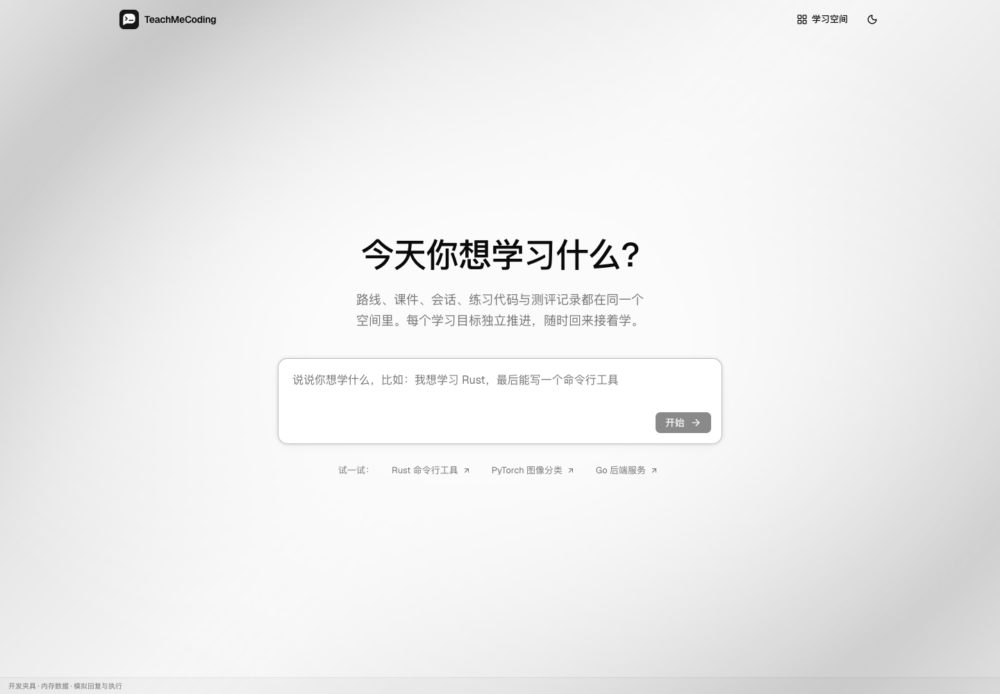

<p align="center">
  
</p>

<h1 align="center">TeachMeCoding</h1>

<p align="center">
  本地运行的 AI 编程教学应用：从学习目标出发，生成路线和课件，在真实项目里练习，并用真实执行结果测评。
</p>

<p align="center">
  
  
  
  
</p>

<p align="center">
  <a href="#快速开始">快速开始</a> ·
  <a href="docs/configuration.md">配置指南</a> ·
  <a href="docs/architecture.md">架构</a> ·
  <a href="docs/development.md">开发与测试</a> ·
  <a href="docs/ROADMAP.md">路线图</a>
</p>


TeachMeCoding 为每个学习目标创建独立的学习空间。教学 Agent 先和你澄清需求，再规划学习路线、编写课件；你在内置 IDE 和本机终端中动手练习，代码题会在本机真实运行后再由模型评估。所有数据保存在本机 SQLite 和项目目录中，服务只有一个 Node 进程。

> [!WARNING]
> Agent 以服务账号的本机权限读取文件、执行 Bash 和访问网络，**不是沙箱**。请只在信任模型、工具和资料的环境中运行，详见 [SECURITY.md](SECURITY.md)。

## 目录

- [功能特性](#功能特性)
- [项目状态](#项目状态)
- [快速开始](#快速开始)
- [使用方式](#使用方式)
- [配置](#配置)
- [项目结构](#项目结构)
- [开发](#开发)
- [文档](#文档)
- [参与贡献](#参与贡献)
- [致谢](#致谢)
- [许可证](#许可证)

## 功能特性

- **完整学习流程**：创建空间 → 澄清并确认需求 → 生成路线 → 学习课件与编程实践 → 测评反馈与继续学习。
- **可调整的学习路线**：按阶段和单元组织，Agent 提出的调整需你确认后才生效；后续单元在前序课件完成后解锁。
- **真实项目与终端**：每个空间对应磁盘上的项目目录，IDE 输入即自动保存，终端是基于 xterm 和 PTY 的真实 shell。
- **基于执行证据的测评**：代码题在本机运行并比对标准输出，支持 Python、JavaScript、TypeScript、Rust 和 Bash。
- **可审阅的文件修改**：辅导 Agent 以 diff 提案修改文件，你确认后才写入。
- **多模型 Provider**：基于 [Pi](https://github.com/earendil-works/pi) 接入多家 Provider，支持 API Key 与 OAuth 登录。
- **资料库**：上传任意格式的参考资料，Agent 按需用原生工具读取，不做向量索引。
- **联网能力**：可选 14 种搜索服务（含无需 API Key 的 DuckDuckGo），以及内置的公开网页抓取。
- **MCP 与 Skills**：在设置中添加 MCP 服务器，从 [skills.sh](https://skills.sh) 浏览和安装 Skills。
- **English 与简体中文界面**，亮色与暗色主题，以及不调用模型的内置演示模式 `/preview`。

<table>
  <tr>
    <td></td>
    <td></td>
  </tr>
  <tr>
    <td align="center">首页</td>
    <td align="center">全屏 IDE</td>
  </tr>
</table>

<sub>截图来自 `/preview` 演示数据。</sub>

## 项目状态

项目处于早期开发阶段。里程碑 M1–M5 已完成并合入 `main`；M6 整体交付验收（完整学习主流程、干净环境启动、备份恢复和最终回归）尚未开始。进度见 [ROADMAP](docs/ROADMAP.md)。

目前只在 **macOS 26 / arm64、Node 24.15.0、Google Chrome** 上实际验证过。Linux、Windows 和 Intel Mac 未经验证。

## 快速开始

### 环境要求

- [Node.js](https://nodejs.org/) 24.15.0（24 LTS）
- [pnpm](https://pnpm.io/) 11.1.0
- Python 3、C/C++ 编译器和 make（编译 `better-sqlite3`、`node-pty`；macOS 安装 Xcode Command Line Tools 即可）
- 可选：测评所需的语言工具链，如 `python3`、`node`、`rustc`

### 安装与启动

```sh
git clone https://github.com/liangxiao777/TeachMeCoding.git
cd TeachMeCoding
pnpm install --frozen-lockfile

pnpm dev    # 开发模式：前端 http://127.0.0.1:5173，API 127.0.0.1:4310
```

生产模式由一个 Node 服务同时提供界面和 API：

```sh
pnpm build
pnpm start  # http://127.0.0.1:4310
```

### 配置模型

启动后打开「设置 → 模型配置」，选择 Provider、模型和登录方式即可。凭据只保存在服务端数据目录，不会返回浏览器。

也可以用环境变量提供初始配置：

```sh
cp .env.example .env
chmod 600 .env
# 编辑 .env，填写 OPENROUTER_API_KEY 和 OPENROUTER_MODEL
```

## 使用方式

1. 在首页描述你想学的内容，例如「我想学习 Rust，最后能写一个命令行工具」。
2. 和 Agent 澄清背景、目标和时间安排，确认需求摘要。
3. 查看生成的学习路线，需要时让 Agent 调整。
4. 逐个单元阅读课件，在 IDE 和终端中练习，随时向 Agent 提问。
5. 完成测评，根据反馈继续学习。

不配置模型也能体验界面：访问 `/preview` 进入演示模式。演示数据只存在于浏览器内存中，不调用模型、不写文件、不执行命令。

## 配置

常用环境变量：

| 变量 | 默认值 | 说明 |
| --- | --- | --- |
| `TMC_DATA_DIR` | `~/.teach-me-coding/` | 数据根目录（数据库、项目文件、资料库、配置） |
| `PORT` | `4310` | API 服务端口（生产模式同时提供界面） |
| `TMC_WEB_PORT` | `5173` | 开发模式前端端口 |
| `HOST` | `127.0.0.1` | 设为 `0.0.0.0` 允许可信局域网访问，**没有登录鉴权** |
| `OPENROUTER_API_KEY` / `OPENROUTER_MODEL` | — | 尚未在设置页保存模型时的初始配置 |
| `TMC_PREVIEW_ORIGIN` | — | 允许 Devin Desktop 等编辑器内置预览的本机来源 |

搜索服务、网页抓取、MCP、Skills、数据备份与恢复等完整说明见[配置指南](docs/configuration.md)。

## 项目结构

```text
apps/
  server/        Node 服务：Hono HTTP、Pi Agent、SQLite 存储、PTY 终端
  web/           React 19 + Vite 前端，Tailwind CSS、AI Elements、CodeMirror、xterm
packages/
  contracts/     前后端共享的类型与协议
tests/           集成测试、Playwright 浏览器测试与视觉基线
docs/            设计文档、配置与开发指南
patches/         pnpm 依赖补丁
```

## 开发

```sh
pnpm check          # 类型检查
pnpm build
pnpm test           # 单元与集成测试，需要先 build
pnpm test:browser   # Playwright 浏览器与截图回归，使用本机 Google Chrome
pnpm test:native    # SQLite 与 PTY 原生依赖检查
pnpm test:provider  # 真实模型冒烟测试，会产生 Provider 费用
```

`pnpm test` 需要本机有 `python3` 和 `pdftotext`（Poppler）。测试端口、夹具、视觉基线更新流程等见[开发与测试](docs/development.md)。

## 文档

- [配置指南](docs/configuration.md)：模型、数据目录、网络访问、搜索、网页抓取、MCP 与 Skills
- [架构与运行机制](docs/architecture.md)：界面、Agent 工具、本机执行、测评、上下文与接口访问边界
- [开发与测试](docs/development.md)：命令、演示夹具、回归测试与兼容性检查
- [界面翻译贡献](docs/translating.md)：翻译流程与检查命令
- [实施计划](docs/implementation-plan.md)、[Agent 上下文设计](docs/agent-context-design.md)、[学习需求确认设计](docs/intake-design.md)
- [ROADMAP](docs/ROADMAP.md)：里程碑与验收记录
- [SECURITY.md](SECURITY.md)：安全模型与漏洞报告

## 参与贡献

欢迎通过 [Issues](https://github.com/liangxiao777/TeachMeCoding/issues) 反馈问题或提出建议。提交 Pull Request 前请：

- 阅读 [AGENTS.md](AGENTS.md) 中的工具与界面设计约定。
- 从 `main` 新建 `<type>/<short-description>` 分支，例如 `feat/local-project-files`。
- 提交信息遵循 [Conventional Commits](https://www.conventionalcommits.org/)，例如 `fix(projects): reject symlink traversal`。
- 确保 `pnpm check`、`pnpm build`、`pnpm test` 通过；涉及界面时同时运行 `pnpm test:browser`。

## 致谢

- [Pi](https://github.com/earendil-works/pi)：Agent 核心、模型接入、MCP 客户端与 Skills 加载
- [AI Elements](https://ai-sdk.dev/elements) 与 [shadcn/ui](https://ui.shadcn.com/)：会话与输入组件
- [OpenClaw](https://github.com/openclaw/openclaw)：搜索与网页抓取工具的参考实现
- [Skills CLI](https://github.com/vercel-labs/skills) 与 [skills.sh](https://skills.sh)
- [xterm.js](https://xtermjs.org/)、[node-pty](https://github.com/microsoft/node-pty)、[better-sqlite3](https://github.com/WiseLibs/better-sqlite3)、[Hono](https://hono.dev/)、[CodeMirror](https://codemirror.net/)

## 许可证

尚未选择开源许可证。在仓库添加 `LICENSE` 文件之前，代码保留所有权利。
