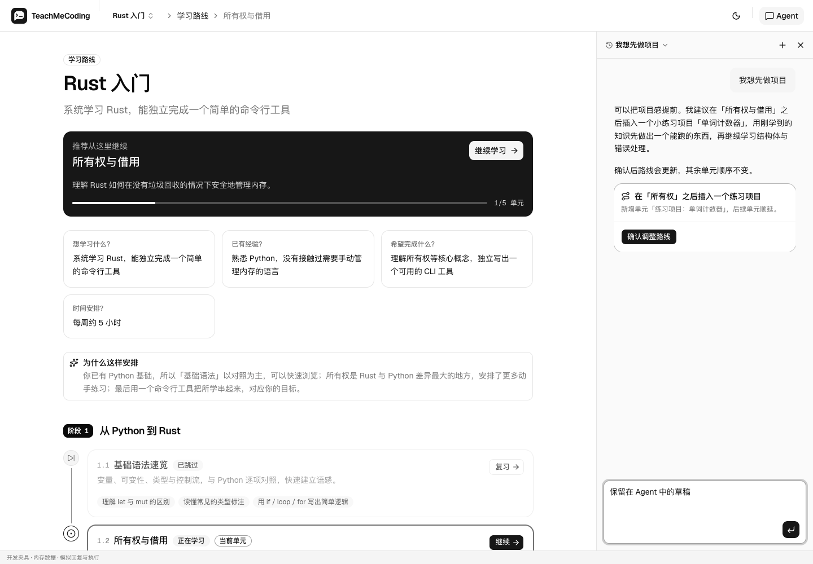
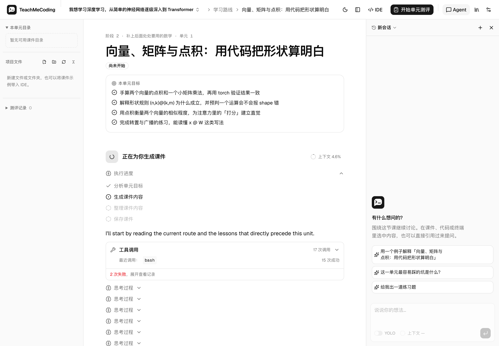
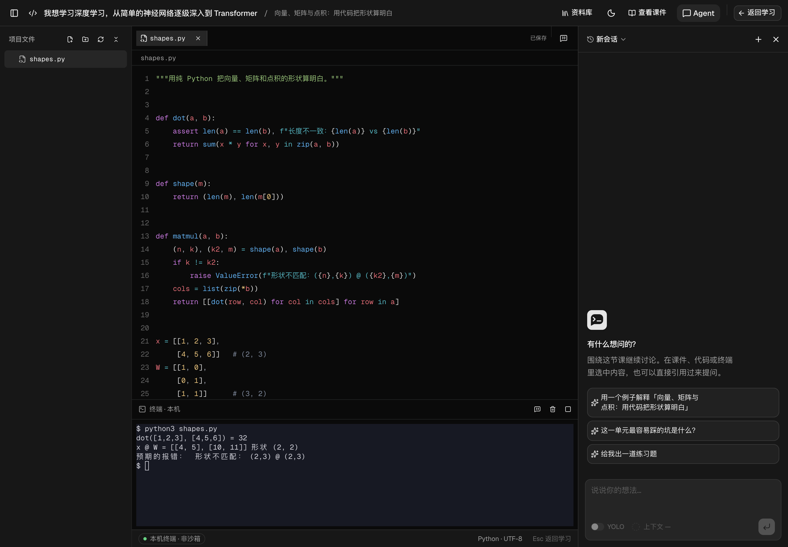

<p align="center">
  
</p>

<h1 align="center">TeachMeCoding</h1>

<p align="center">
  <a href="README.md">English</a> · 简体中文
</p>

<p align="center">
  本地运行的 AI 编程教学应用：从学习目标出发，生成路线和课件，在真实项目里练习，并用真实执行结果测评。
</p>

<p align="center">
  <a href="LICENSE"></a>
  
  
  
  
</p>

<p align="center">
  <a href="#快速开始">快速开始</a> ·
  <a href="#文档">文档</a> ·
  <a href="CONTRIBUTING.zh.md">参与贡献</a> ·
  <a href="SECURITY.zh.md">安全</a>
</p>



TeachMeCoding 为每个学习目标创建独立的学习空间。教学 Agent 先和你澄清需求，再规划学习路线、编写课件；你在内置 IDE 和本机终端中动手练习，代码题在本机真实运行后再由模型评估。所有数据保存在本机的 SQLite 和项目目录中，整个应用只需一个 Node 进程。

> [!WARNING]
> Agent 以运行服务的系统账号权限读取文件、执行 Bash 和访问网络，**不是沙箱**。请只在你信任模型、工具和资料的环境中运行，详见 [SECURITY.zh.md](SECURITY.zh.md)。

## 目录

- [功能特性](#功能特性)
- [项目状态](#项目状态)
- [快速开始](#快速开始)
- [使用方式](#使用方式)
- [配置](#配置)
- [文档](#文档)
- [参与贡献](#参与贡献)
- [致谢](#致谢)
- [许可证](#许可证)

## 功能特性

- **完整学习流程**：澄清需求 → 规划路线 → 学习课件与编程练习 → 测评与反馈。
- **可调整的学习路线**：按阶段和单元组织，单元在前序课件完成后依次解锁。
- **真实项目与终端**：每个学习空间对应磁盘上的项目目录；编辑器输入即自动保存，终端是真实的 shell。
- **基于执行证据的测评**：代码题在本机运行并比对输出，支持 Python、JavaScript、TypeScript、Rust 和 Bash。
- **改动先确认再生效**：路线调整、课件重写、文件修改和学习结论都以提案呈现；也可以按会话开启 YOLO 模式自动接受。
- **多模型 Provider**：基于 [Pi](https://github.com/earendil-works/pi) 接入多家 Provider，支持 API Key 与 OAuth 登录，并显示上下文用量。
- **资料库**：上传任意格式的参考资料，Agent 按需读取。
- **联网能力**：14 种可选的搜索服务（含无需 API Key 的 DuckDuckGo）和内置的网页抓取。
- **MCP 与 Skills**：在设置中添加 MCP 服务器，从 [skills.sh](https://skills.sh) 浏览和安装 Skills。
- **English 与简体中文界面**，以及亮色与暗色主题。

<table>
  <tr>
    <td></td>
    <td></td>
  </tr>
  <tr>
    <td align="center">课件生成</td>
    <td align="center">全屏 IDE 与本机终端</td>
  </tr>
</table>

<sub>截图来自本机实际运行的学习空间。</sub>

## 项目状态

项目处于早期开发阶段，尚未发布正式版本，功能、接口和数据格式都可能变化。

源码安装**仅支持 macOS 和 Linux（Ubuntu/Debian）**；不支持 Windows。

本地验证使用 Node 24.15.0，已在 **macOS 26 / arm64** 和非 root 的 **Debian 12 / arm64 Docker** 环境中通过安装、类型检查、构建、测试及 SQLite/PTY 检查；macOS 还通过了 Google Chrome 浏览器执行测试。Linux 浏览器检查**仅限 x86_64**，Linux arm64 仅完成后端/原生依赖验证；Intel Mac 尚未验证。测试命令和 CI 覆盖范围见[开发指南](docs/development.zh.md#测试)。

## 快速开始

### 环境要求

- [Node.js](https://nodejs.org/) 24.15.0
- [pnpm](https://pnpm.io/) 11.1.0
- `PATH` 中的 Git 和 Bash。

原生依赖（`better-sqlite3`、`node-pty`）在没有可用预编译二进制时需要 Python 3 和编译工具。macOS 的 `node-pty` 补丁始终从源码编译。

| 系统 | 原生编译依赖 |
| --- | --- |
| macOS | Python 3 和 Xcode Command Line Tools（`xcode-select --install`） |
| Linux（Ubuntu/Debian） | `sudo apt-get update && sudo apt-get install -y git bash build-essential python3` |

代码测评需要的其他语言工具链（如 `rustc`）请自行安装并加入 `PATH`。Python 测评需要 `python3`。Agent 不会自动安装缺少的工具链。

### 安装与启动

以下命令从源码运行本地 Node/Web 应用。安装工具后请重新打开终端，使更新后的 `PATH` 生效。

```sh
npm install --global pnpm@11.1.0
git clone https://github.com/liangxiao777/TeachMeCoding.git
cd TeachMeCoding
pnpm install --frozen-lockfile
pnpm build
pnpm start
```

打开 <http://127.0.0.1:4310>。开发时可以改用 `pnpm dev`（前端 <http://127.0.0.1:5173>），见[开发指南](docs/development.zh.md)。

### 配置模型

打开「设置 → 模型配置」，选择 Provider、模型和登录方式。凭据只保存在本机的数据目录中（默认 `~/.teach-me-coding/`），不会返回浏览器。

## 使用方式

1. 在首页描述你想学的内容，例如「我想学习 Rust，最后能写一个命令行工具」。
2. 回答 Agent 关于背景、目标和时间安排的问题，确认需求摘要。
3. 查看生成的学习路线，需要时让 Agent 调整。
4. 逐个单元阅读课件，在 IDE 和终端中练习，随时向 Agent 提问。
5. 完成测评，根据反馈继续学习。

## 配置

- **启动参数**（数据目录、端口、监听地址等）通过环境变量或项目根目录的 `.env` 设置，参考 [`.env.example`](.env.example)。
- **模型、搜索、MCP 和 Skills** 在应用的「设置」页面管理。

默认只监听 `127.0.0.1`。设置 `HOST=0.0.0.0` 可以在局域网中访问，但**没有登录鉴权**，只应在可信网络中使用。

全部选项、数据目录结构和备份方法见[配置文档](docs/configuration.zh.md)。

## 文档

- [配置](docs/configuration.zh.md)：启动参数、模型、数据目录与备份、局域网访问、搜索、网页抓取、MCP、Skills
- [架构](docs/architecture.zh.md)：组成部分、Agent 场景与工具、提案与 YOLO 模式、运行生命周期、本机执行边界
- [开发指南](docs/development.zh.md)：开发环境、项目结构与测试
- [界面翻译](docs/translating.zh.md)：翻译约定与检查
- [参与贡献](CONTRIBUTING.zh.md)：问题反馈与 Pull Request 流程
- [安全策略](SECURITY.zh.md)：安全模型与漏洞报告

## 参与贡献

欢迎通过 [Issues](https://github.com/liangxiao777/TeachMeCoding/issues) 反馈问题或提出建议。提交 Pull Request 前请阅读 [CONTRIBUTING.zh.md](CONTRIBUTING.zh.md)。

## 致谢

- [Pi](https://github.com/earendil-works/pi)：Agent 核心、模型接入、MCP 客户端与 Skills 加载
- [AI Elements](https://ai-sdk.dev/elements) 与 [shadcn/ui](https://ui.shadcn.com/)：会话与输入组件
- [OpenClaw](https://github.com/openclaw/openclaw)：搜索与网页抓取工具的参考实现
- [Skills CLI](https://github.com/vercel-labs/skills) 与 [skills.sh](https://skills.sh)
- [xterm.js](https://xtermjs.org/)、[node-pty](https://github.com/microsoft/node-pty)、[better-sqlite3](https://github.com/WiseLibs/better-sqlite3)、[Hono](https://hono.dev/)、[CodeMirror](https://codemirror.net/)

## 许可证

本项目基于 [Apache License 2.0](LICENSE) 开源。

Copyright 2026 lxiao（[@liangxiao777](https://github.com/liangxiao777)）
